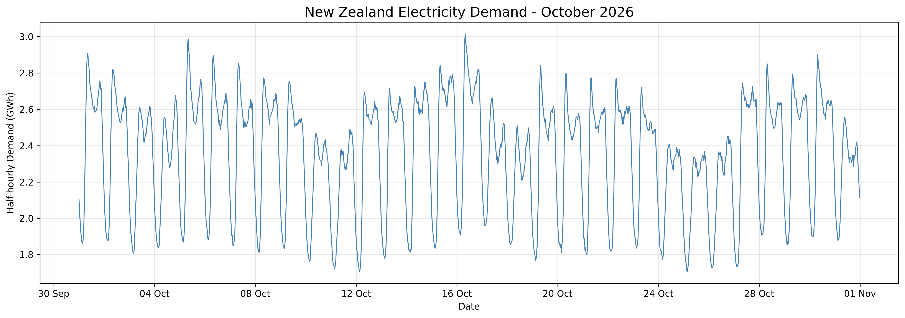
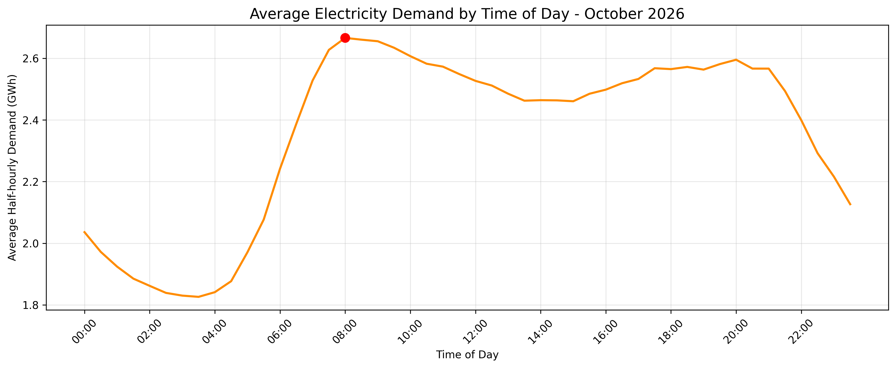
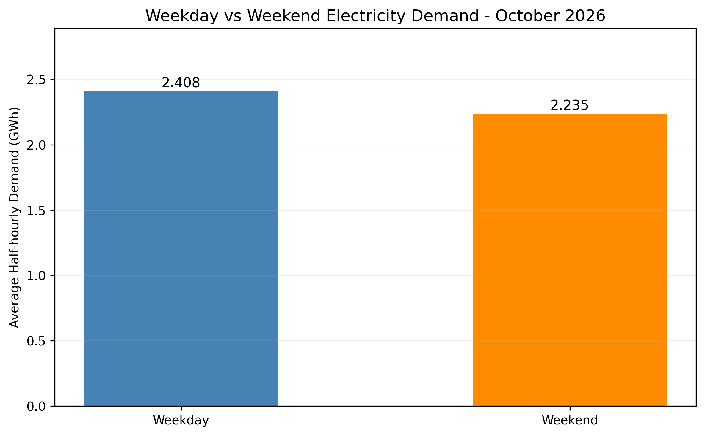
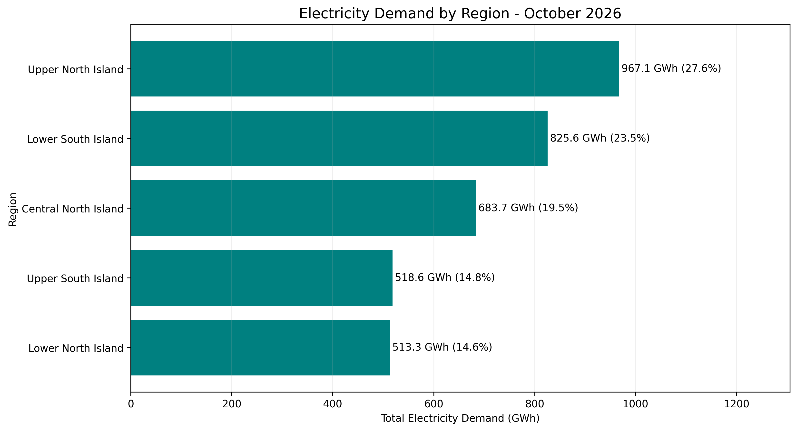

# New Zealand Electricity Demand Analysis

### October 2026 | Python Data Analysis Project

## About This Project

I'm a first-year Computer Science and Mathematics student at Victoria University of Wellington, with an interest in quantitative analysis.

I wanted to practise working with real-world data outside university, so I explored New Zealand's electricity demand using publicly available data from the Electricity Authority.

This project focuses on data processing, descriptive statistics, visualisation, and interpreting results.

## Data and Tools

- **Data source:** [Electricity Authority — EMI](https://www.emi.ea.govt.nz/)
- **Period:** 1–31 October 2026
- **Tools:** Python, Pandas, Matplotlib, Google Colab
- **Dataset:** 7,440 records across five electricity zones

## Visualisations

### 1. National Electricity Demand Trends

This chart shows how national half-hourly electricity demand changed throughout October 2026.

### 2. Average Demand by Time of Day

Average demand was highest during 08:00–08:30 and lowest during 03:30–04:00.

### 3. Weekday vs Weekend Demand

Average half-hourly demand was approximately 7.18% lower on weekends than on weekdays.

### 4. Electricity Demand by Region

The Upper North Island recorded the highest total demand among the five electricity zones.

## Key Findings

- **Total national demand:** 3,508.224 GWh
- **Average half-hourly demand:** 2.358 GWh
- **Highest average demand period:** 08:00–08:30
- **Lowest average demand period:** 03:30–04:00
- **Weekday average:** 2.408 GWh
- **Weekend average:** 2.235 GWh
- **Highest-demand region:** Upper North Island (967.056 GWh)

## Limitations

This analysis covers October 2026 only, so the findings should not be generalised to the entire year.

Public holidays are included in the weekday category. The analysis uses descriptive statistics and does not establish the causes of demand changes.

Electricity demand is reported as energy in GWh for each half-hourly trading period, rather than instantaneous power.

## What I Learned

This project helped me gain practical experience using Python to work with real electricity market data.

I learned how to group and summarise data, create visualisations, and communicate quantitative findings.

I'm interested in developing these skills further by exploring seasonal demand patterns and the relationship between electricity demand and wholesale prices.

## How to Run

1. Download the notebook and CSV file from this repository.
2. Open `NZ_Electricity_Market_Analysis.ipynb` in Google Colab.
3. Upload the CSV file into the Colab session.
4. Run the notebook cells in order.

## Data Attribution

Source: Electricity Authority New Zealand, Electricity Market Information (EMI), Demand trends report, October 2026.
